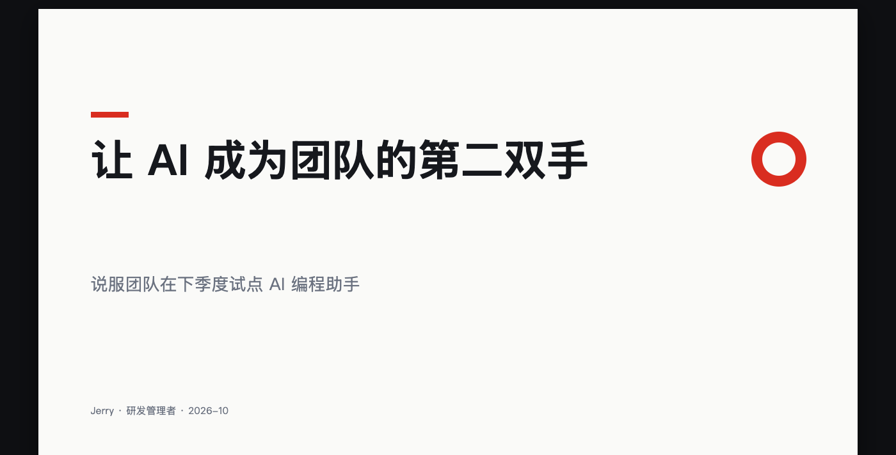
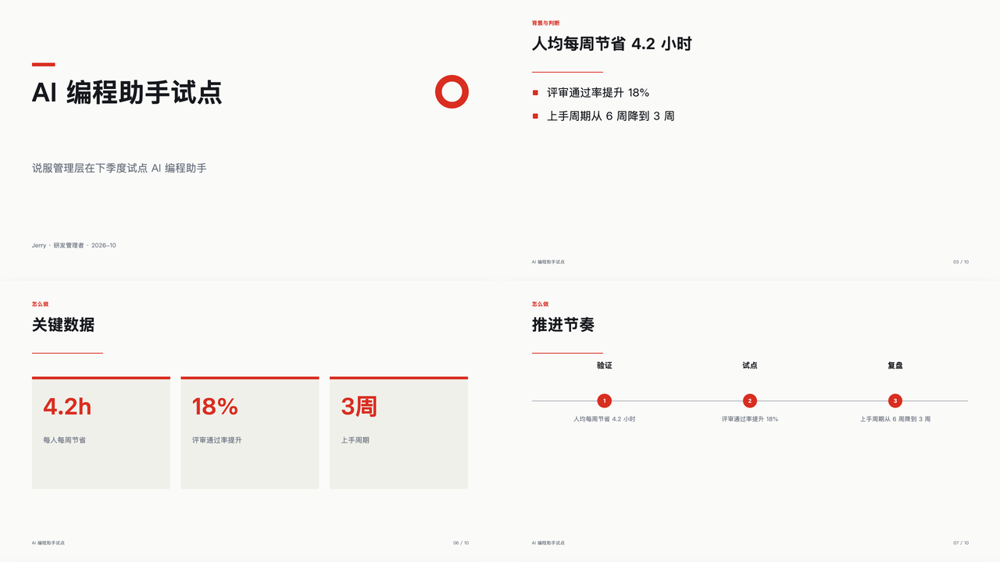

# ppt-agent

从一份 brief 生成**可编辑 PPTX** 的演示文稿 agent：模型负责内容，代码负责版式。

它不做花哨的截图拼贴，而是用 python-pptx 写出原生形状与文本框——交付后可以直接在 PowerPoint / WPS / Keynote 里改字、换图、调顺序。同时给出 HTML 预览、Markdown 讲稿和一份确定性质检报告。



## 30 秒上手

```bash
cd ppt-agent
python3 -m pip install -r requirements.txt

make run      # 离线生成示例，产物在 tmp/demo/decks/demo/
make evals    # 37 条评测
make test     # 33 条单元测试
make check    # 结构自检
```

打开 `tmp/demo/decks/demo/preview.html` 看效果，`deck.pptx` 是交付物。

## 一条命令生成自己的 deck

```bash
python3 src/ppt.py --root out --slug q4 init \
  --topic "季度复盘" --slides 12 --theme ocean \
  --audience "管理团队" --goal "对齐结果、问题与下季度三个重点" \
  --points "收入环比增长 12%;两个项目延期;聚焦两个行业;补齐交付人力"

python3 src/ppt.py --root out --slug q4 pipeline
```

或者用完整 brief：

```bash
python3 src/ppt.py --root out --slug q4 pipeline --brief templates/brief-example.json
```

## 产出

| 文件 | 用途 |
|---|---|
| `deck.pptx` | 16:9 原生 PPTX，可编辑 |
| `preview.html` | 浏览器预览，可打印为 PDF |
| `deck.md` | 逐页要点 + 讲稿 |
| `deck.json` | 结构化成稿，便于二次加工 |
| `qa.json` | 质检报告（溢出、密度、讲稿、一致性） |
| `run.jsonl` | 结构化日志（阶段、耗时、token） |

## 命令

| 命令 | 作用 |
|---|---|
| `init` | 写 brief，校验参数 |
| `outline` | 生成页面骨架（版式 + 标题 + 要点） |
| `compose` | 填成稿（要点、数据、讲稿） |
| `render` | 输出 PPTX / HTML / Markdown / qa.json |
| `check` | 质检；有阻断项退出码 1 |
| `pipeline` | 一次跑完 outline → check |
| `status` | 查看进度 |
| `inspect` | 回读任意 PPTX 的结构与文本 |
| `eval` | stdin 读 JSON 的评测入口 |

## 设计取舍

1. **模型管内容，代码管几何**：模型只产出结构化字段，坐标、字号、配色由 9 个版式函数计算。溢出在写文件前就能算出来。
2. **两阶段生成**：`outline` 定结构，`compose` 填文案；中间落盘，可检查、可重跑。借鉴自 [PPTAgent](https://github.com/icip-cas/PPTAgent) 的分析→生成两阶段。
3. **渲染后回读**：`render` 结束重新打开 PPTX，确认页数、标题、备注真的写入。借鉴自 [DeepPresenter](https://arxiv.org/abs/2602.22839) 的 grounded reflection。
4. **一份几何，三种输出**：PPTX、HTML 预览、QA 共用同一份 Scene，预览与交付物不会不一致。
5. **离线可跑**：mock 模式不调模型，评测结果稳定；没有密钥也能完整体验。
6. **失败显式**：参数、结构、溢出、主题问题都有 `code/message/hint`；阻断项让命令退出码为 1，不静默降级。

## 版式与主题

9 种版式：`title`、`section`、`bullets`、`two-col`、`stats`、`timeline`、`quote`、`image`、`closing`。



4 套内置主题：`swiss`（白底红）、`ocean`（深蓝）、`warm`（暖米）、`ink`（深黑金）。自定义主题见 `themes/custom-example.json`。

```bash
python3 src/ppt.py --root out --slug q4 render --theme themes/custom-example.json
```

## 接真实模型

支持任何 OpenAI 兼容接口（DeepSeek、通义、Moonshot、OpenAI……）：

```bash
export PPT_PROVIDER=openai
export PPT_BASE_URL=https://api.deepseek.com/v1
export PPT_MODEL=deepseek-chat
export PPT_API_KEY=sk-...
```

密钥只从环境变量读，`.env` 已在 `.gitignore`。提示词在 `prompts/`，改完必须重跑 `make evals`。

## 评测

37 条用例，覆盖：

- 入口校验（空主题、页数越界、非法 JSON、未知命令）
- 页数边界（3 页 / 30 页）
- 主题与语言（4 套主题、英文 deck）
- 质检缺陷（超长标题、溢出、重复标题、缺讲稿、空内容、图片缺失）
- 状态（重复 init）与自定义章节

```bash
make evals       # 对比基线，跌幅 >5% 判回归
make baseline    # 全绿后更新基线
```

## 项目结构

```
ppt-agent/
├── src/deck/           # 代码
│   ├── cli.py          # 命令与 eval 入口
│   ├── stages.py       # 流水线
│   ├── model.py        # brief / outline / deck 校验
│   ├── layouts.py      # 9 种版式
│   ├── scene.py        # 与后端无关的图元
│   ├── textfit.py      # 文本宽度与溢出估算
│   ├── render.py       # PPTX / HTML / Markdown
│   ├── checks.py       # 质检
│   ├── mock.py         # 离线内容生成
│   └── providers.py    # 模型提供方
├── prompts/            # 提示词（与代码分开）
├── docs/               # 需求卡、设计、契约、ADR、运行手册
├── evals/              # 37 条用例 + 基线
├── tests/              # 33 条单元测试
├── themes/             # 自定义主题示例
└── templates/          # brief 示例
```

## 借鉴与致谢

- [PPTAgent](https://github.com/icip-cas/PPTAgent)（EMNLP 2025）：两阶段生成、编辑式填页、内容/设计/连贯三维评估。
- [DeepPresenter](https://arxiv.org/abs/2602.22839)（ACL 2026）：环境 grounded 的反思与回读校验。
- [Presenton](https://github.com/presenton/presenton)：主题令牌、可编辑 PPTX 导出、命令 + JSON 契约。
- [presentation_agent](https://github.com/xueyouluo/presentation_agent)：HTML 幻灯片与人工视觉复核。
- [python-pptx](https://github.com/scanny/python-pptx)：PPTX 读写基础。

## 本版不做

在线编辑器、配图生成、图表、模板归纳、多模态视觉评审、多 agent 协作。取舍理由见 [docs/design.md](docs/design.md)。
